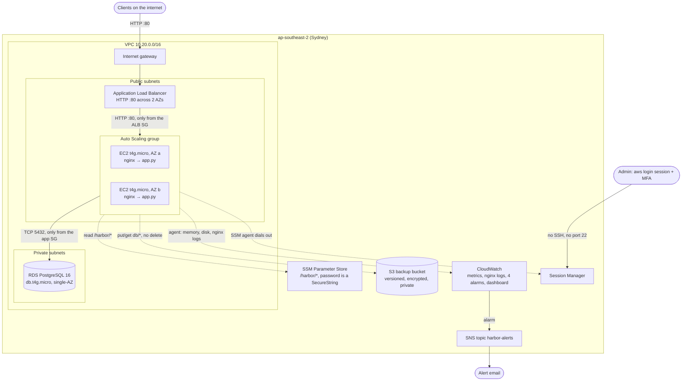

# AWS Cloud Homelab: "Harbor Point" client portal

A hands-on AWS lab aimed at **junior cloud, cloud support and cloud operations roles in the Philippines.** The fictional **Harbor Point Accounting** (the same 20-person firm from my [Windows AD homelab](https://github.com/deadnme/windows-ad-homelab)) moves its client portal from an office server to AWS. I build it with Terraform, run it, break it on purpose, and fix it the way a cloud support engineer would.

> **About this project:** this is a **learning lab**, not production experience. The guide, Terraform code and scripts were written with AI assistance (Claude). **I'm the one building it:** I set up the AWS account, type and run every command, troubleshoot what breaks, and work the break-fix tickets without looking at the answers. The docs only show output I actually saw in my own account. Sections marked _"My output"_ get filled in as I complete each module.

## What employers ask for, and where it's covered

Before building, I reviewed entry-level and junior cloud postings in the Philippines (AWS partners, BPO/telco cloud ops teams, the AWS Cloud Support Associate role) in October 2026, with AI-assisted web research. The same skills kept coming up:

| Employers ask for | Where it's covered in this lab |
|---|---|
| AWS core services: EC2, VPC, IAM, S3, RDS, ELB, CloudWatch | Docs 03–08 |
| Linux administration: services, logs, permissions | Doc 04 (Amazon Linux 2023, `systemd`, `journalctl`, nginx) |
| Networking: subnets, routing, DNS, firewalls, troubleshooting tools | Doc 03, doc 11, break-fix tickets BF-1/2/3/7 |
| Infrastructure as code (Terraform preferred) | [`terraform/`](terraform/), built up one file per doc |
| Scripting (Bash / Python) | [`scripts/`](scripts/): first-boot Bash, backup script, `cloud_health_report.py` (doc 09) |
| Monitoring, health checks, first-level troubleshooting | Docs 05, 08, 11 and eight break-fix tickets in doc 12 |
| Cost and billing awareness | Docs 01 and 13: budget alerts, tagging, teardown proof, Cost Explorer report |
| Docker basics | Doc 10 |
| AWS Cloud Practitioner → Solutions Architect Associate | Interview questions at the end of every doc follow the CLF-C02 / SAA-C03 topics |

## Architecture

- **Subnets:** public `10.20.1.0/24` (AZ a) and `10.20.2.0/24` (AZ b) route to the internet gateway. Private `10.20.11.0/24` and `10.20.12.0/24` have no route to the internet.
- **Lines:** solid lines are network traffic. Dotted lines are AWS API calls made with the instance role, and the Session Manager channel. Those calls leave through the internet gateway, because the lab has no NAT Gateway and no VPC endpoints.
- **Metrics:** only the disk alarm uses agent data. CPU, unhealthy targets and ALB 5xx come from metrics AWS publishes itself.
- **Not drawn:** account-level guards set up in doc 01: an AWS Budgets alert ($5/month) and CloudTrail event history.

Why each part is built this way, what else was considered, and what production would change: **[design decisions](docs/design-decisions.md)**.

**Deliberate cost trade-offs** (and what production would do instead):

| This lab | Production | Why the lab differs |
|---|---|---|
| App instances in public subnets, locked down by security groups | Private subnets plus a NAT Gateway or VPC endpoints | A NAT Gateway costs roughly $43/month in Sydney |
| RDS single-AZ, 1-day backups | RDS Multi-AZ, longer retention, deletion protection | Doubles the database cost |
| HTTP on the load balancer's DNS name | HTTPS with ACM and a Route 53 domain | Needs a paid domain |
| Local Terraform state | S3 backend with locking | One person, one environment |
| The project's managed full-access role + `aws login` | IAM Identity Center with permission sets | A new-experience project doesn't support Identity Center without activating advanced features |

## Cost rules

1. A budget alert exists before any resource does (doc 01).
2. Terraform tags every resource `Project=aws-cloud-homelab`.
3. Every session ends with `terraform destroy`. With everything running, the lab costs roughly **$0.10/hour** of credits.
4. Doc 13 proves nothing was left behind and records the real total from Cost Explorer.

## Step-by-step documentation

Each page follows the same layout: **Goal → Why a company does this → What gets built → Steps → Verify → Common mistakes → Interview questions**.

| # | Page | You'll learn | Status |
|---|---|---|---|
| 00 | [What is AWS](docs/00-what-is-aws.md) | Regions, AZs, shared responsibility, billing, AD lab → AWS map | 📖 read |
| 01 | [Account setup and hardening](docs/01-account-setup-and-hardening.md) | New AWS experience sign-up, Region, MFA, budget, CloudTrail | 📝 to run |
| 02 | [Workstation tooling](docs/02-workstation-tooling.md) | AWS CLI, `aws login`, Terraform smoke test, the `lab/` folder | 📝 to run |
| 03 | [VPC networking](docs/03-vpc-networking.md) | Subnets, route tables, internet gateway, SG vs NACL, CIDR math | 📝 to run |
| 04 | [Linux on EC2](docs/04-linux-on-ec2.md) | User data, `systemd`, logs, IMDSv2, Session Manager instead of SSH | 📝 to run |
| 05 | [Load balancer and Auto Scaling](docs/05-load-balancer-and-auto-scaling.md) | Health checks, SG chaining, self-healing, rolling updates | 📝 to run |
| 06 | [RDS PostgreSQL](docs/06-rds-postgresql.md) | Private database, Parameter Store secrets, `psql` | 📝 to run |
| 07 | [S3 and IAM roles](docs/07-s3-and-iam-roles.md) | Backups to S3, least privilege, AccessDenied, policy simulator | 📝 to run |
| 08 | [CloudWatch monitoring](docs/08-cloudwatch-monitoring.md) | Agent, log groups, Logs Insights, alarms → email, dashboard | 📝 to run |
| 09 | [Automation: cloud health report](docs/09-automation-cloud-health-report.md) | Python + boto3 account checks | 📝 to run |
| 10 | [Docker](docs/10-docker.md) | Images, layers, containers; ECR/ECS/EKS | 📝 to run |
| 11 | [Troubleshooting and lessons](docs/11-troubleshooting-and-lessons.md) | A repeatable method and toolkit; what broke for me | 📝 to run |
| 12 | [Break-fix tickets](docs/12-break-fix-tickets.md) | Eight faults found and fixed from the ticket alone | 📝 to run |
| 13 | [Teardown and cost report](docs/13-teardown-and-cost-report.md) | Proving nothing is left; the real total cost | 📝 to run |
| – | [Design decisions](docs/design-decisions.md) | Why each part is built this way, the alternatives, and what production would change | 📖 read |
| – | [Glossary](docs/glossary.md) | Every term in one place | 📖 read |

## Repository layout

| Path | Contents |
|---|---|
| `docs/` | The pages above |
| `terraform/` | The finished lab: one root module, one file per doc (`network.tf`, `compute.tf`, `alb.tf`, `rds.tf`, `s3.tf`, `monitoring.tf`) |
| `app/` | The portal (`app.py`, Python standard library + boto3 + psycopg) and its `Dockerfile` |
| `scripts/` | `user-data.sh.tftpl` (first boot), `cloud_health_report.py` + its self-test |
| `breakfix/` | `break.ps1` / `restore.ps1` for the doc 12 tickets (**spoilers**: don't read before solving) |
| `tools/` | `gen_note.py`: rebuilds my single-page Obsidian copy of the guide from the docs and code |
| `.github/workflows/terraform.yml` | `terraform fmt` and `validate` on every push. No AWS credentials in GitHub |
| `screenshots/`, `media/` | Real screenshots and the demo video from my account |

> ⚠️ Before every push: `git grep -nE "A(KI|SI)A[0-9A-Z]{16}|aws_secret_access_key *=|aws_session_token *="` must return nothing, and `git status` must not list any `.tfstate` file or `lab/`.

## Skills practised

AWS (IAM, VPC, EC2, ELB, Auto Scaling, RDS, S3, CloudWatch, CloudTrail, SNS, Budgets, Systems Manager) · Terraform · AWS CLI · Linux (Amazon Linux 2023, systemd, nginx) · networking · PostgreSQL · Python (boto3) · Bash · PowerShell · Docker · troubleshooting · cost control · documentation
