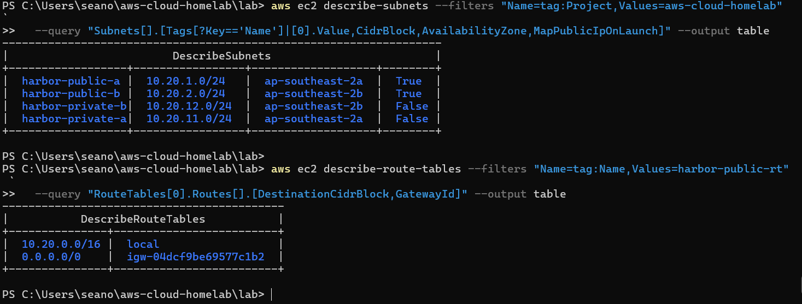

# 03 · VPC networking

> **Goal:** build Harbor Point's private network in AWS: one VPC across two Availability Zones, with public subnets for the web tier and private subnets for the database. Learn what actually makes a subnet "public".

## Why a company does this

A VPC is the company's own isolated network inside AWS, like the `HarborNet` NAT Network in the AD lab, but spread over two data centres. Every later resource (servers, load balancer, database) lives in a subnet of this VPC. If the network design is wrong, nothing above it can be fixed by settings. A network that is hard to change later is the first thing a cloud team designs.

## Key decisions

| Decision | My choice | Why |
|---|---|---|
| VPC CIDR | `10.20.0.0/16` (65,536 addresses) | Private range (RFC 1918). Doesn't overlap the AD lab's `10.10.10.0/24`, so the two could be joined by VPN later |
| Subnets | Four `/24`s: public `10.20.1.0/24`, `10.20.2.0/24`; private `10.20.11.0/24`, `10.20.12.0/24` | One public and one private per AZ. Easy to read: 1x = public, 1x = private |
| AZs | The first two available in `ap-southeast-2` | High availability needs at least two |
| Internet access for private subnets | **None** (no NAT Gateway) | Only the database lives there, and it never needs the internet. Saves roughly $43/month |
| Network ACLs | The VPC's default (allow all) | Security groups do the filtering |

### CIDR math you will be asked about

| CIDR | Addresses | Usable in AWS | Why |
|---|---|---|---|
| `/16` | 65,536 | 65,536 minus 5 per subnet | — |
| `/24` | 256 | **251** | AWS reserves 5 per subnet: `.0` network, `.1` VPC router, `.2` DNS, `.3` reserved, `.255` broadcast |
| `/28` | 16 | 11 | Smallest subnet AWS allows |

## What makes a subnet public?

Nothing on the subnet itself. A subnet is public **only because its route table has a route `0.0.0.0/0 → internet gateway`.** Instances also need a public IP to be reachable (`map_public_ip_on_launch`).

| Route table | Routes | Used by |
|---|---|---|
| `harbor-public-rt` | `10.20.0.0/16 → local`, `0.0.0.0/0 → harbor-igw` | `harbor-public-a`, `harbor-public-b` |
| `harbor-private-rt` | `10.20.0.0/16 → local` only | `harbor-private-a`, `harbor-private-b` |

The `local` route is automatic and can't be removed. It's why everything inside the VPC can reach everything else, *if security groups allow it*.

## Security groups vs network ACLs

| | Security group | Network ACL |
|---|---|---|
| Attached to | A network interface (instance, ALB, RDS) | A subnet |
| Rules | Allow only | Allow **and** deny, numbered, first match wins |
| State | **Stateful**: replies are allowed automatically | **Stateless**: replies need their own outbound rule (ephemeral ports 1024-65535) |
| Can reference | Other security groups (doc 05) | CIDR ranges only |
| Typical use | The main firewall for each resource | Blunt subnet-wide blocks (e.g. block one bad IP range) |

## Console tour (look, don't click "Create")

**VPC console** → **Your VPCs**. Every account has a **default VPC** (`172.31.0.0/16`) in each Region. This lab doesn't use it. A company would usually delete it, so nobody launches into it by accident.

Open **Subnets**, **Route tables** and **Internet gateways** to see the default VPC's versions of what we're about to build. **Create VPC → VPC and more** shows a preview diagram of the same layout. Look at the diagram, then cancel. Terraform builds ours.

## Build it with Terraform

Read [`terraform/network.tf`](../terraform/network.tf) top to bottom first. Then:

```powershell
cd $HOME\aws-cloud-homelab\lab
Copy-Item ..\terraform\network.tf .
terraform plan     # count the resources: VPC, IGW, 4 subnets, 2 route tables, 1 route, 4 associations
terraform apply
```

This costs nothing: VPCs, subnets, route tables and internet gateways are free. (NAT Gateways, public IPv4 addresses and VPC endpoints are not.)

### Cost allocation tags (skip in a new-experience project)

On a classic account you would now activate the `Project` tag: **Billing and Cost Management** → **Cost allocation tags** → `Project` → **Activate**, so Cost Explorer can filter spend by `Project=aws-cloud-homelab`. In a new-experience project the page says *"This feature is only available in enterprise AWS"*: it needs advanced features, which this lab doesn't activate (doc 01). **Skip it.** The project holds only the lab, so group Cost Explorer by **Service** instead. The tags still exist on every resource, and doc 02's leftover check reads them through the tagging API, which doesn't need activation.

## Verify it worked

```powershell
terraform output

aws ec2 describe-subnets --filters "Name=tag:Project,Values=aws-cloud-homelab" `
  --query "Subnets[].[Tags[?Key=='Name']|[0].Value,CidrBlock,AvailabilityZone,MapPublicIpOnLaunch]" --output table

aws ec2 describe-route-tables --filters "Name=tag:Name,Values=harbor-public-rt" `
  --query "RouteTables[0].Routes[].[DestinationCidrBlock,GatewayId]" --output table
```

Expected: four subnets in two AZs, `MapPublicIpOnLaunch` true only for the public ones; the public route table shows `0.0.0.0/0` going to an `igw-…` ID.

In the console: **VPC → Your VPCs → harbor-vpc → Resource map** draws subnets, route tables and the gateway with lines between them.

**My output** (from my own account):



## Common mistakes

| Mistake | Result |
|---|---|
| Overlapping CIDRs with another network | VPC peering or VPN to it is impossible later. Plan ranges up front |
| Forgetting the IGW route | "Public" subnet with no internet: instances can't install packages, ALB can't answer users |
| `enable_dns_hostnames = false` | RDS endpoints and some services don't resolve the way you expect |
| Putting the database in a public subnet "to test" | One wrong security group rule away from a database on the internet |
| Thinking NACLs are stateful | Inbound allowed, replies dropped: connections hang |

## Interview questions

- **"What makes a subnet public?"** A route to an internet gateway in its route table. Instances also need a public IP.
- **"How many usable IPs in a /24 in AWS?"** 251. AWS reserves five addresses per subnet.
- **"Security group vs NACL?"** SGs are stateful, allow-only and attached to interfaces. NACLs are stateless, allow and deny, and attached to subnets.
- **"How would a private instance download updates?"** Through a NAT Gateway in a public subnet, or VPC endpoints for AWS services (S3 gateway endpoints are free). This lab avoids both by keeping only the database private.
- **"What is the default VPC?"** A ready-made VPC in every Region with public subnets in each AZ. Handy for tests, risky for production.
- **"How do you connect a VPC to an office network?"** Site-to-Site VPN over the internet, or Direct Connect for a private line. Joining two VPCs: VPC peering or a Transit Gateway.

⬅️ [02 · Workstation tooling](02-workstation-tooling.md) | ➡️ [04 · Linux on EC2](04-linux-on-ec2.md)
