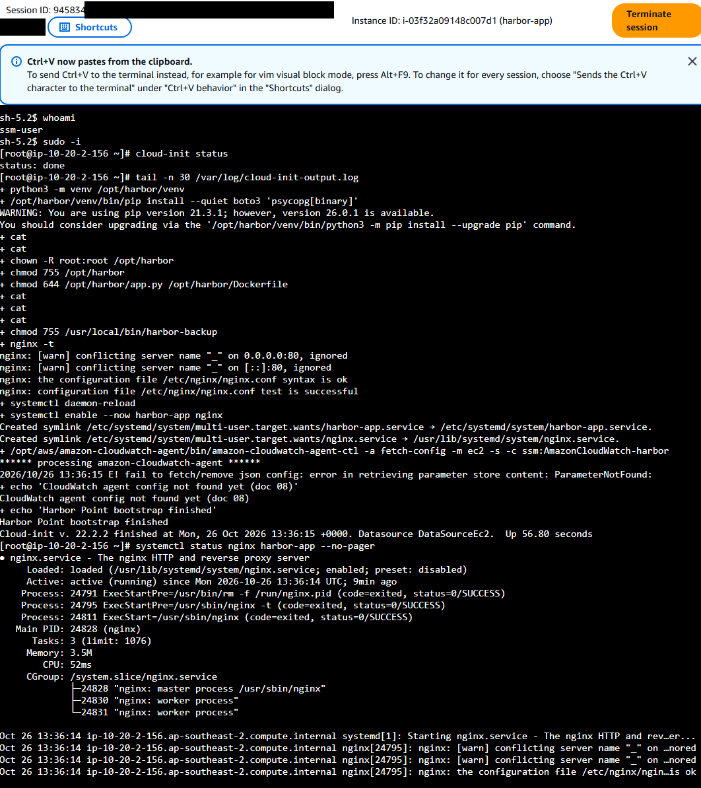
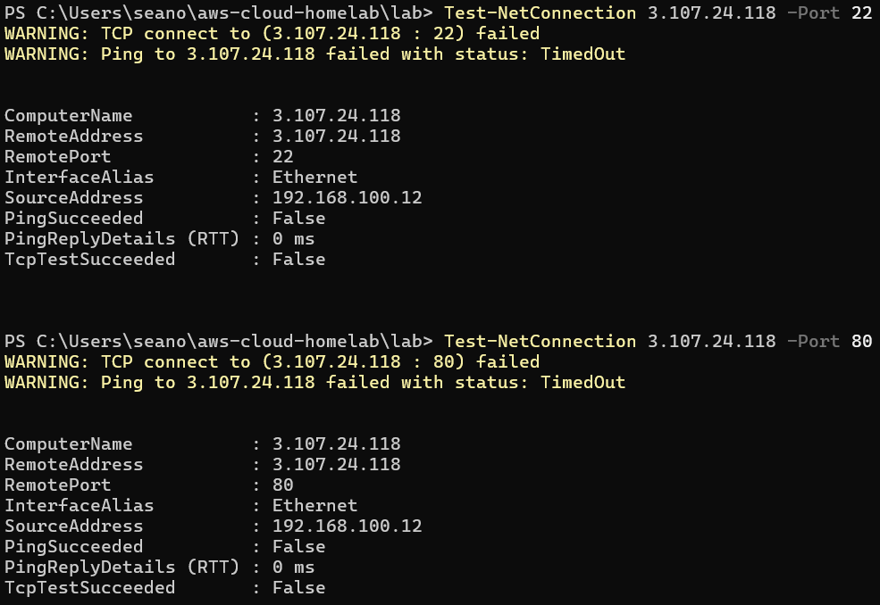

# 04 · Linux app servers on EC2 (with Session Manager, no SSH)

> **Goal:** launch two Amazon Linux 2023 servers, one per AZ, that install and run the Harbor Point portal by themselves on first boot. Get a root shell on them **without SSH, without a key pair and without opening port 22**, then do the everyday Linux admin checks a cloud support engineer runs.

## Why a company does this

Servers that configure themselves from a script can be replaced at any time, and that's what makes auto scaling and self-healing (doc 05) possible. Nobody "fixes" a server by hand and hopes to remember what they did.

Port 22 open to the internet is the most attacked port there is. **Session Manager** gives a shell through the AWS API instead. Access is controlled by IAM, every session is logged in CloudTrail, and there are no SSH keys to lose.

## What gets built ([`terraform/compute.tf`](../terraform/compute.tf))

| Resource | Purpose |
|---|---|
| `harbor-app-sg` | Security group: **no inbound rules at all** for now. Outbound allowed (packages, SSM, S3) |
| `harbor-app-role` + instance profile | The servers' identity. `AmazonSSMManagedInstanceCore` (Session Manager) + read `/harbor/*` parameters |
| Launch template | AMI (latest AL2023 for Arm), `t4g.micro`, encrypted gp3 disk, **IMDSv2 required**, user data script |
| `harbor-app-asg` | Auto Scaling group: keeps **2** instances running across both public subnets |

### The first-boot script

Read [`scripts/user-data.sh.tftpl`](../scripts/user-data.sh.tftpl). On first boot, as root, it:

1. installs `nginx`, the CloudWatch agent and the PostgreSQL client with `dnf`,
2. creates a system user `harbor` with no login shell,
3. builds a Python virtual environment in `/opt/harbor/venv` and installs `boto3` and `psycopg`,
4. writes the app ([`app/app.py`](../app/app.py)) and a `systemd` unit `harbor-app.service`,
5. configures nginx on port 80 as a reverse proxy to the app on `127.0.0.1:8080`,
6. writes `/usr/local/bin/harbor-backup` (used in doc 07),
7. enables and starts `harbor-app` and `nginx`.

```
 user ──► :80 nginx ──► 127.0.0.1:8080 harbor-app (python, runs as user "harbor")
                                         │
                                         └── reads /harbor/* from SSM Parameter Store (doc 06)
```

## Build it

```powershell
cd $HOME\aws-cloud-homelab\lab
Copy-Item ..\terraform\compute.tf .
terraform apply
```

`terraform plan` shows the AMI ID as a normal value: the data source reads the public SSM parameter `/aws/service/ami-amazon-linux-latest/al2023-ami-kernel-default-arm64`, so the newest Amazon Linux is used without a hard-coded ID.

**Costs start now:** two `t4g.micro` instances plus two public IPv4 addresses, roughly $0.03/hour in Sydney. `terraform destroy` at the end of the session.

Watch the launch: **EC2 → Auto Scaling groups → harbor-app-asg → Activity**. Two "Launching a new EC2 instance" entries appear, one per AZ.

Check what the role really has:

```powershell
aws iam list-attached-role-policies --role-name harbor-app-role --query "AttachedPolicies[].PolicyName" --output text
```

Expected: only `AmazonSSMManagedInstanceCore`. A new-experience project may attach extra AWS managed policies (such as `PowerUserAccess`) to new roles by itself. `compute.tf` makes Terraform own the full list of attached policies, so `terraform apply` removes any extra one. If one keeps coming back, write it down in doc 11: doc 07's least-privilege tests depend on it.

## Get a shell with Session Manager

List the instances:

```powershell
aws ec2 describe-instances `
  --filters "Name=tag:Name,Values=harbor-app" "Name=instance-state-name,Values=running" `
  --query "Reservations[].Instances[].[InstanceId,Placement.AvailabilityZone,PrivateIpAddress,PublicIpAddress]" `
  --output table
```

Wait 2-3 minutes after launch for the SSM agent to register, then:

```powershell
aws ssm start-session --target i-0123456789abcdef0     # use one of your instance IDs
```

(Console alternative: **EC2 → Instances → select → Connect → Session Manager → Connect**.)

## Linux admin checklist (run inside the session)

```bash
whoami                     # ssm-user: Session Manager's own account
sudo -i                    # become root (ssm-user has sudo)

# Did first boot finish?
cloud-init status          # "status: done" when the user data script finished
tail -n 30 /var/log/cloud-init-output.log    # ends with "Harbor Point bootstrap finished"

# Services
systemctl status nginx harbor-app --no-pager
journalctl -u harbor-app -n 20 --no-pager    # the app's own log lines
ss -tlnp                   # nginx on :80, python on 127.0.0.1:8080; sshd still listens on :22,
                           # but no security group rule lets anyone reach it

# Does it answer?
curl -s localhost/health   # ok
curl -s localhost/ | grep "Served by"

# Files, users, permissions
ls -l /opt/harbor /etc/systemd/system/harbor-app.service
id harbor                  # system user; the app does not run as root
getent passwd harbor       # shell is /sbin/nologin

# Resources
df -h /                    # root disk usage (the disk alarm in doc 08 watches this)
free -m
uptime

# Instance metadata, IMDSv2 style (a token first, then the request)
TOKEN=$(curl -sX PUT http://169.254.169.254/latest/api/token -H "X-aws-ec2-metadata-token-ttl-seconds: 60")
curl -s -H "X-aws-ec2-metadata-token: $TOKEN" http://169.254.169.254/latest/meta-data/placement/availability-zone; echo
curl -s http://169.254.169.254/latest/meta-data/instance-id; echo   # no token: 401, because IMDSv1 is off

exit; exit
```

Practise the service basics while you're there: `systemctl restart harbor-app`, then `systemctl stop harbor-app` and see `curl -s -o /dev/null -w "%{http_code}\n" localhost/` return **502** (nginx is up, the app behind it isn't), then `systemctl start harbor-app`.

## Prove nothing is exposed

From your laptop (PowerShell):

```powershell
$ip = aws ec2 describe-instances --filters "Name=tag:Name,Values=harbor-app" "Name=instance-state-name,Values=running" --query "Reservations[0].Instances[0].PublicIpAddress" --output text
Test-NetConnection $ip -Port 22    # TcpTestSucceeded : False
Test-NetConnection $ip -Port 80    # TcpTestSucceeded : False (no inbound rules yet; doc 05 adds the load balancer)
```

The servers have public IPs only so they can reach the internet without a NAT Gateway. The security group still lets nothing in.

## Verify it worked

| Check | Expected |
|---|---|
| ASG | 2 instances `InService`, one in each AZ |
| `cloud-init status` | `status: done` |
| `curl -s localhost/health` (inside) | `ok` |
| Port 22 and 80 from the laptop | Both fail |
| CloudTrail Event history (Sydney), event `StartSession` | Your `AccountFullAccessRole` session, with your IP |
| `aws iam list-attached-role-policies --role-name harbor-app-role` | Only `AmazonSSMManagedInstanceCore` |

**My output** (from my own account):





## Common mistakes

| Mistake | Result |
|---|---|
| Session Manager plugin not installed | `SessionManagerPlugin is not found` (doc 02) |
| Starting a session right after launch | `TargetNotConnected`: the agent hasn't registered yet. Wait a few minutes |
| No instance role, or role without `AmazonSSMManagedInstanceCore` | Instance never appears in **Systems Manager → Fleet Manager** |
| No outbound internet (no public IP, no NAT, no endpoints) | SSM agent can't reach SSM; user data can't `dnf install` |
| Editing files on a server by hand | The next instance refresh replaces the server and your change is gone. Change the template instead |
| Leaving IMDSv1 on | A server-side request forgery bug can steal the instance role's credentials |

## Interview questions

- **"How do you connect to a Linux instance without SSH?"** AWS Systems Manager Session Manager. It needs the SSM agent, an instance role with `AmazonSSMManagedInstanceCore`, and a network path to the SSM endpoints. No inbound ports, no keys, logged in CloudTrail.
- **"What is user data?"** A script (or cloud-init config) that runs as root on first boot. Its log is `/var/log/cloud-init-output.log`.
- **"An instance launched but the app isn't working. Where do you look?"** `cloud-init status` and `/var/log/cloud-init-output.log` (did bootstrap finish?), `systemctl status`, `journalctl -u <service>`, `ss -tlnp` (is anything listening?), `curl localhost` (does it answer locally?), then the security group.
- **"What is IMDSv2 and why require it?"** The metadata service with a session token obtained by a PUT request. It blocks SSRF attacks that trick an app into fetching `169.254.169.254` and leaking role credentials.
- **"How does code on an EC2 instance get AWS permissions?"** Through the instance profile (an IAM role). The SDK picks up short-lived credentials from the metadata service. No access keys on the server.
- **"Why Arm (t4g) instead of t3?"** Graviton instances cost less for the same work. Most Linux software and Python run on Arm unchanged.
- **"What does nginx do here?"** Reverse proxy: it owns port 80, handles HTTP and logging, and passes requests to the app on localhost. The app never faces the network directly.

⬅️ [03 · VPC networking](03-vpc-networking.md) | ➡️ [05 · Load balancer and Auto Scaling](05-load-balancer-and-auto-scaling.md)
