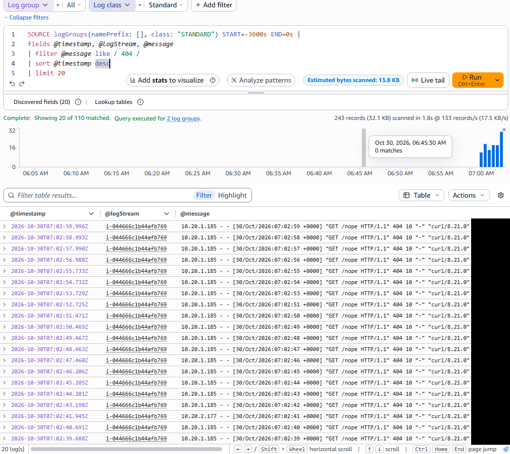
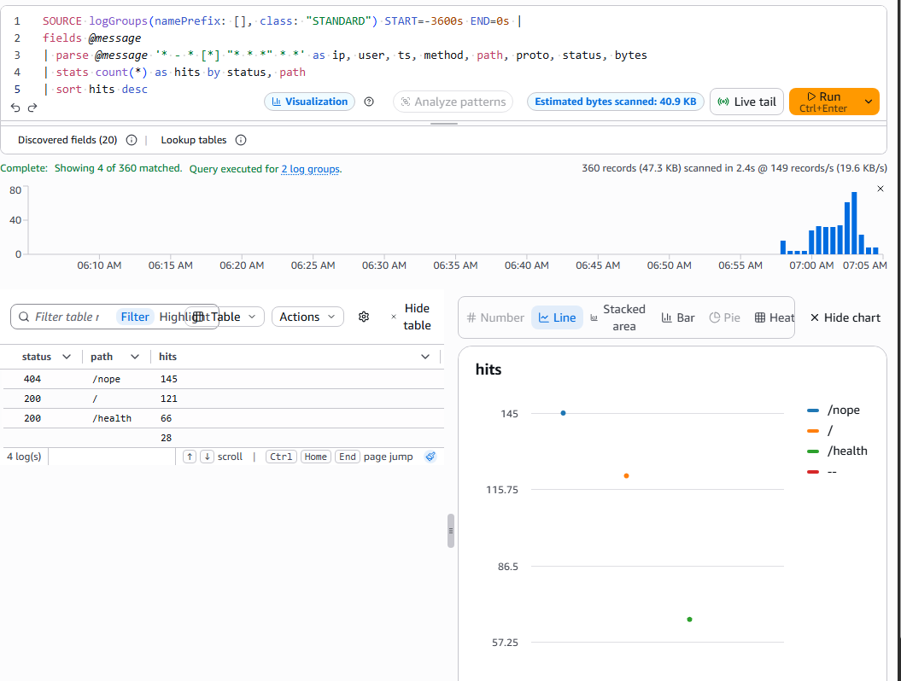
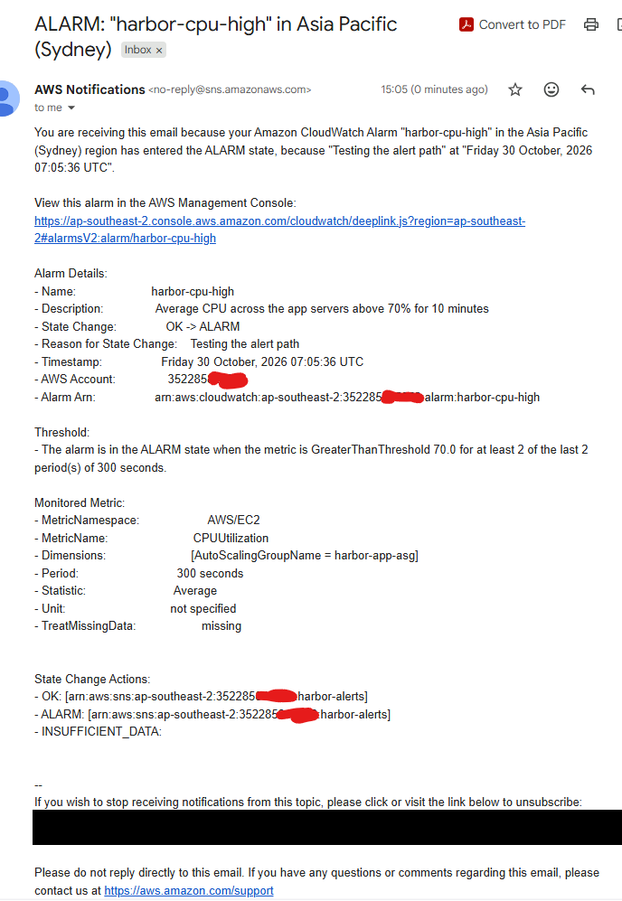

# 08 · CloudWatch monitoring and alerting

> **Goal:** see what the servers, load balancer and database are doing, ship the nginx logs off the servers, and get an email when something goes wrong, before a client calls.

## Why a company does this

Servers in an Auto Scaling group come and go. A log file on a server that was replaced at 3 a.m. is gone. Monitoring has to live **outside** the servers: metrics and logs in CloudWatch, alarms that page someone. "Monitor the environment and respond to alerts" is in almost every cloud ops and NOC job post.

## What gets built ([`terraform/monitoring.tf`](../terraform/monitoring.tf))

| Piece | Detail |
|---|---|
| SNS topic `harbor-alerts` + email subscription | Where every alarm sends its message |
| CloudWatch agent config in SSM (`AmazonCloudWatch-harbor`) | Memory and disk % every 60 s; tails `/var/log/nginx/access.log` and `error.log` |
| `harbor-cloudwatch-agent` role policy | Lets the agent publish metrics and write to **these two** log groups. It's AWS's managed `CloudWatchAgentServerPolicy` minus `logs:CreateLogGroup`: Terraform owns the log groups, so an agent can't recreate them while `terraform destroy` runs |
| Log groups `/harbor/nginx/access`, `/harbor/nginx/error` | 7-day retention; one stream per instance ID |
| Alarm `harbor-cpu-high` | Average CPU > 70% for 10 min |
| Alarm `harbor-unhealthy-targets` | Any target failing the health check for 2 min |
| Alarm `harbor-alb-5xx` | ≥ 5 ALB-generated 5xx in 5 min (e.g. 503: no registered targets; 502: bad answer from a target) |
| Alarm `harbor-disk-high` | Any server's root disk > 80% |
| Dashboard `harbor-portal` | Requests, errors, healthy hosts, CPU/memory/disk, database |

> 🎓 **Why the agent?** EC2's built-in metrics come from the hypervisor: CPU, network, disk I/O. The hypervisor can't see inside the OS, so **memory and disk-space usage need the CloudWatch agent.**

Cost: within the always-free CloudWatch allowance for this size (10 alarms, 10 custom metrics, 3 dashboards, 5 GB of logs per month). Agent metrics count per instance, and replaced instances add new ones, so check credits in **AWS Settings → Billing** after a long session.

## Build it

The alert email address is a variable with no default. Put it in a git-ignored file:

```powershell
cd $HOME\aws-cloud-homelab\lab
Set-Content terraform.tfvars 'alert_email = "you@example.com"'    # your real address
Copy-Item ..\terraform\monitoring.tf .
terraform apply
```

1. **Confirm the subscription:** AWS emails "AWS Notification - Subscription Confirmation". Click the link. Until then, alarms have nowhere to go.
2. **Start the agent on the servers.** They booted before the agent config existed. Replace them with the new config the clean way, an instance refresh:

```powershell
aws autoscaling start-instance-refresh --auto-scaling-group-name harbor-app-asg
aws autoscaling describe-instance-refreshes --auto-scaling-group-name harbor-app-asg `
  --query "InstanceRefreshes[0].[Status,PercentageComplete]" --output text
```

(The manual way, inside a Session Manager shell, is `sudo /opt/aws/amazon-cloudwatch-agent/bin/amazon-cloudwatch-agent-ctl -a fetch-config -m ec2 -s -c ssm:AmazonCloudWatch-harbor`.)

## Use it

**Dashboard:** `terraform output -raw dashboard_url`, open it in the browser. Generate some traffic so the graphs move:

```powershell
$url = terraform output -raw alb_url
1..200 | ForEach-Object { curl.exe -s -o NUL $url; curl.exe -s -o NUL "$url/nope" }   # 200s and 404s
```

**Logs:** **CloudWatch → Logs → Log groups → /harbor/nginx/access** shows one stream per server. Then **Logs Insights** → select `/harbor/nginx/access` → run:

```
fields @timestamp, @logStream, @message
| filter @message like / 404 /
| sort @timestamp desc
| limit 20
```

```
fields @message
| parse @message '* - * [*] "* * *" * *' as ip, user, ts, method, path, proto, status, bytes
| stats count(*) as hits by status, path
| sort hits desc
```

**Alarms:** test the alerting path without breaking anything:

```powershell
aws cloudwatch set-alarm-state --alarm-name harbor-cpu-high --state-value ALARM --state-reason "Testing the alert path"
```

An "ALARM: harbor-cpu-high" email arrives within a minute. The alarm returns to OK on its next evaluation (another email).

## Verify it worked

| Check | Expected |
|---|---|
| SNS subscription | **Confirmed** (SNS console → Subscriptions) |
| **CloudWatch → Metrics → CWAgent** | `mem_used_percent`, `disk_used_percent` by `AutoScalingGroupName` |
| Log group `/harbor/nginx/access` | One stream per instance, new lines appear as you browse |
| Logs Insights | Your 404s listed |
| Test alarm | ALARM email received, then OK |
| All 4 alarms | State `OK` (or `Insufficient data` for disk until the agent reports) |

**My output** (from my own account):







## Common mistakes

| Mistake | Result |
|---|---|
| Not confirming the SNS email | Alarms fire into nothing |
| Agent config parameter not named `AmazonCloudWatch-*` | Agent can't read it: the agent policy (here and in AWS's managed `CloudWatchAgentServerPolicy`) only allows that prefix |
| Alarm on one instance ID in an Auto Scaling group | Instance replaced → alarm watches a dead instance. Alarm on the ASG instead |
| Letting the agent create log groups | They get "never expire" retention and survive `terraform destroy` |
| Alarms with `treat_missing_data = missing` on sparse metrics | Stuck in `INSUFFICIENT_DATA` forever |
| Alert on everything | Alert fatigue: people stop reading the emails. Alert on symptoms clients feel |

## Interview questions

- **"Which EC2 metrics need the CloudWatch agent?"** Memory and disk-space usage (anything inside the OS). CPU, network and disk I/O come built in.
- **"What are an alarm's three states?"** `OK`, `ALARM`, `INSUFFICIENT_DATA`.
- **"How would you find all 5xx errors from the last hour?"** CloudWatch Logs Insights on the access log group, filtering on the status field. For ALB-wide counts, the `HTTPCode_ELB_5XX_Count` / `HTTPCode_Target_5XX_Count` metrics.
- **"CloudWatch vs CloudTrail?"** CloudWatch: performance metrics, logs and alarms ("how is it running?"). CloudTrail: API audit log ("who changed what?").
- **"How do you get notified?"** Alarm → SNS topic → email, SMS, chat (via Amazon Q Developer in chat applications, formerly AWS Chatbot) or a ticketing system webhook.
- **"How do you monitor what clients actually see?"** Health checks and 5xx alarms on the load balancer, plus synthetic checks from outside (CloudWatch Synthetics canaries). Internal metrics alone miss things like a broken security group in front of the site.

⬅️ [07 · S3 and IAM roles](07-s3-and-iam-roles.md) | ➡️ [09 · Automation: cloud health report](09-automation-cloud-health-report.md)
